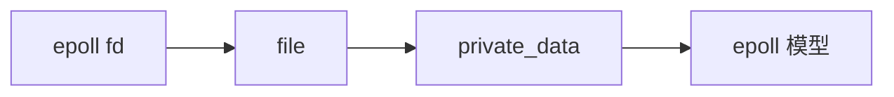
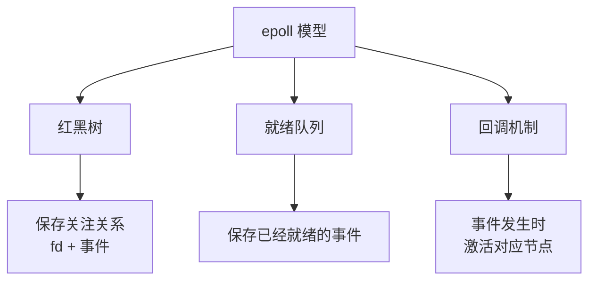
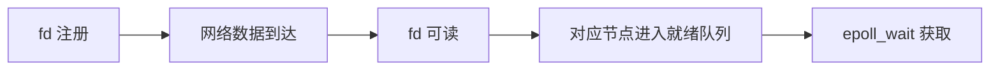
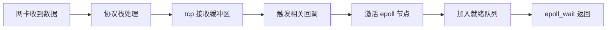
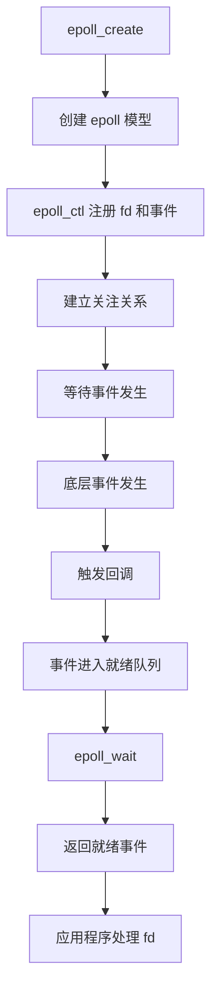
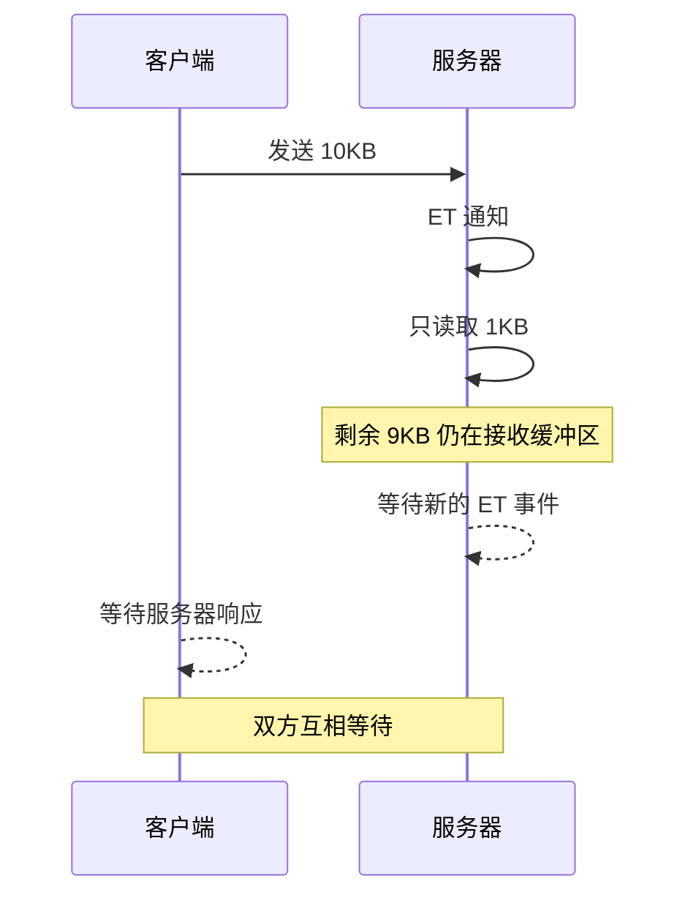
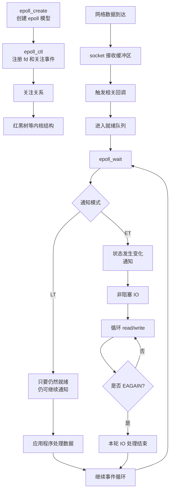


+++
date = 2026-10-13
title = "聊聊 epoll：三个接口、三块结构、两种模式"
description = ""
slug = ""
authors = []
tags = ["IO", "epoll"]
series = ["Linux网络编程"]
featuredImage = "assets/cover.png"
toc = true
+++


## 1 epoll 模型接口
### 1.1 epoll 解决的问题

select/poll 每次调用都需要：

1. 把关注的 fd 传给内核。
2. 内核遍历 fd，寻找就绪事件。

问题：

- 用户态和内核态交互频繁。
- fd 数量增加后，遍历成本变高。

epoll 的思想：

**用户提前向内核注册关注的 fd 和事件，事件发生后由内核通知用户。**

---

### 1.2 epoll 三个核心接口

**epoll_create**：

创建 epoll 模型，返回一个文件描述符。

Linux 将 epoll 对象文件化：



内部主要涉及：

- 关注关系
- 就绪队列
- 事件回调相关机制

**epoll_ctl**：

作用：向内核注册、修改、删除监听事件。

```c
epoll_ctl(epfd, op, fd, event);
```

常见操作：

| 操作 | 含义 |
|---|---|
| `EPOLL_CTL_ADD` | 添加 |
| `EPOLL_CTL_MOD` | 修改 |
| `EPOLL_CTL_DEL` | 删除 |

从整体模型来看，它负责修改 epoll 的**关注关系**。


**在关闭文件描述符之前一定要先从 epoll 解除其关系，因为 epoll 只能处理有效文件描述符**。


**epoll_wait**：

作用：获取已经就绪的事件。

`epoll_wait()` 返回的是已经就绪的事件，而不是重新把所有 fd 遍历一遍。

因此可以把它理解为：

```text
epoll_wait()
    ↓
从就绪队列获取已经就绪的事件
    ↓
返回给用户程序
```

---

## 2 epoll 的三个核心结构

| 结构 | 回答的问题 |
|---|---|
| 红黑树 | 我要关注什么？ |
| 回调机制 | 事件发生后怎么通知 epoll？ |
| 就绪队列 | 什么已经发生？ |



### 2.1 红黑树：记录“关注什么”

例如：

```text
fd = 3
关注 EPOLLIN
```

调用 `epoll_ctl(EPOLL_CTL_ADD, ...)` 后，内核建立相应的关注关系。

因此：**红黑树保存 epoll 当前关注的 fd 及其事件。**


### 2.2 就绪队列：记录“发生什么”
就绪队列表示：

```text
什么已经发生
```

例如：



因此： **epoll_wait 的重点不是重新扫描所有 fd，而是获取已经进入就绪状态的事件。**

### 2.3 回调机制：事件发生后主动通知

epoll 的重要特点是事件驱动，而不是不断轮询。

以 socket 可读为例：



可以把这条链记成：

> **事件发生 → 回调 → 就绪队列 → epoll_wait 返回**

---

## 3. epoll 的完整工作流程



到这里解决的是：**epoll 如何管理 fd，以及一个事件发生后如何进入“就绪状态”。**

但还有一个问题：

> **同一个 fd 已经就绪以后，epoll 应该什么时候再次通知应用程序？**

这就是 LT 和 ET。

---

## 4. LT 与 ET

epoll 可以采用两种事件通知模式：

- **LT（Level Trigger，水平触发）**
- **ET（Edge Trigger，边缘触发）**

更准确地说： **LT 和 ET 描述的是“事件就绪后如何通知应用程序”，而不是两种不同的 IO 操作。**

**epoll_wait 返回 ≠ 数据已经处理完。**

Linux 手册明确说明：未指定 `EPOLLET` 时，epoll 默认采用 LT。

### 4.1 LT：只要处于就绪状态，就可以继续通知

LT 的核心：**只要 fd 对应的就绪条件仍然存在，就可以继续通知。**

例如 socket 接收缓冲区中有数据：

```text
接收缓冲区有数据
        ↓
      EPOLLIN
        ↓
   epoll_wait 返回
```

如果应用程序只读取了一部分：

```text
原来：100 字节
读取： 50 字节
剩余： 50 字节
```

剩余 50 字节仍然意味着：

```text
fd 仍然可读
```

因此下一次 `epoll_wait()` 仍然可以得到这个 fd 的可读事件。

所以：

**LT 关注的是“当前是否仍然处于就绪状态”。**

---

### 4.2 ET：关注状态变化

ET 的核心：**只有监视对象的状态发生变化时才产生相应通知。**

以 socket 接收缓冲区为例：

```text
原来没有数据
      ↓
来了数据
      ↓
状态发生变化
      ↓
产生通知
```

如果应用程序只读取一部分：

```text
原来：10 KB
读取： 1 KB
剩余： 9 KB
```

这时：

```text
缓冲区仍然有数据
```

但并没有因为“仍然有 9 KB”而产生一个新的状态变化。

这个过程就像边缘触发器一样。


---

## 5 ET 模式常见问题

### 5.1 ET 模式效率为什么高

这里有个误区：~~一次 read 完 ≠ 本轮 socket 数据读完 ≠ 完整应用层报文读完。~~

ET 模式下，如果 IO 没有再次就绪，就不会通知用户。这就要求程序员一次性读完该 IO 缓冲区内容。

因此，ET 模式下必须要将文件描述符设置为非阻塞模式，循环读。

知道读到 `EWOULDBLOCK` 或 `EAGAIN` ，代表读完了。

ET 模式下，单位时间内，有效处理 IO 、提醒用户的次数就多了。

ET 模式的效率就更高了。


### 5.2 ET 为什么可能导致“等不到下一次通知”

来看一个典型场景。

假设：

```text
客户端 → 服务器
```

客户端发送：

```text
10 KB 请求
```

服务器规定：

> 必须收到完整请求后才返回响应。

客户端又规定：

> 收到服务器响应后才发送下一次数据。




 **ET 最大的风险之一，就是应用程序没有正确消费当前事件对应的数据。**


### 5.3 一次拿不完所有就绪事件怎么办？

假设：

```text
当前有 100 个 fd 就绪
```

但是：

```cpp
epoll_event events[64];
```

那么一次最多返回：

```text
64 个
```

并不意味着剩余 36 个 fd 就消失了。

下一次：

```text
epoll_wait()
```

还可以继续获取剩余的就绪事件。


因此：

**events 数组大小决定一次最多取多少事件，而不是 epoll 最多只能管理多少 fd。**

---


# 6 基于 epoll 的服务器整体流程

现在把三部分内容真正串起来。




